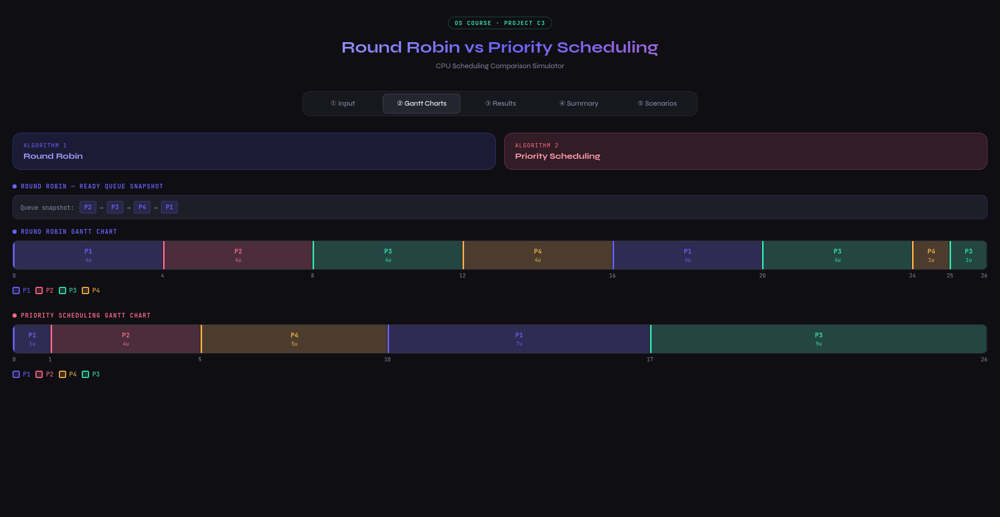
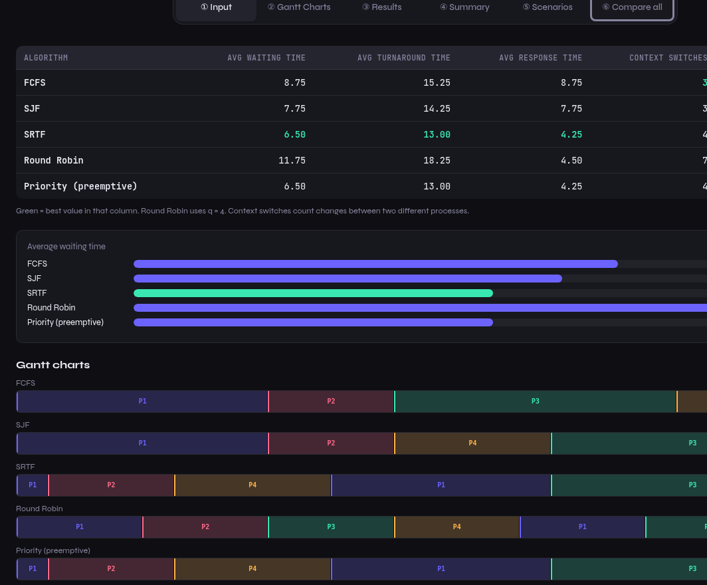

# Round Robin vs Priority Scheduling

A modern, interactive CPU scheduling simulator. Compare FCFS, SJF, SRTF, Round Robin and Priority scheduling on the same workload, with an animated CPU and ready-queue view, Gantt charts and per-process metrics.

Built using HTML, CSS, and JavaScript ES6 Modules.

This project compares **Round Robin (RR)** and **Preemptive Priority Scheduling** using interactive process input, animated Gantt charts, detailed metrics, and workload analysis.

---

# Live Demo

https://hassan3443.github.io/cpu-scheduling-project/

---

# Features

* Interactive process input table
* Round Robin Scheduling simulation
* Preemptive Priority Scheduling simulation
* **Compare all** tab: FCFS, SJF, SRTF, Round Robin and Priority on the same workload, with context switches and CPU utilisation
* Automated tests (`npm test`) and GitHub Actions CI
* Dynamic Gantt Charts
* Waiting Time (WT) calculation
* Turnaround Time (TAT) calculation
* Response Time (RT) calculation
* Average metrics comparison
* Fairness vs urgency analysis
* Ready Queue snapshot visualization
* Built-in testing scenarios
* Dark modern UI

---

# Algorithms Used

## 1. Round Robin (RR)

* Uses a fixed time quantum
* Processes rotate fairly in the ready queue
* Prevents starvation
* Better for interactive systems

## 2. Preemptive Priority Scheduling

* Higher priority processes execute first
* Lower number = higher priority
* Can preempt currently running processes
* Better for urgent or real-time tasks

---

# Metrics Calculated

| Metric | Meaning         |
| ------ | --------------- |
| WT     | Waiting Time    |
| TAT    | Turnaround Time |
| RT     | Response Time   |

---

# Project Structure

```text
cpu-scheduling-project/
├── index.html
├── README.md
├── assets/
│   ├── css/style.css
│   ├── js/main.js
│   └── screenshots/
├── tests/algorithms.test.js
├── .github/workflows/test.yml
├── package.json                      # only for npm test
└── modules/
    ├── input/inputManager.js          # Input and validation
    ├── algorithms/
    │   ├── roundRobin.js
    │   ├── priority.js
    │   ├── fcfs.js
    │   ├── sjf.js                    # SJF and SRTF
    │   └── common.js
    ├── ui/
    │   ├── inputUI.js
    │   ├── compareView.js
    │   ├── ganttChart.js
    │   └── tableRenderer.js
    ├── testing/testScenarios.js       # 5 built-in scenarios
    └── analysis/
        ├── analysis.js               # RR vs Priority comparison and starvation check
        └── compareAll.js             # All five algorithms
```

---

# Team Contributions

| Team Member        | Contribution                           |
| ------------------ | -------------------------------------- |
| Hassan Ashraf      | Input Validation & Process Management  |
| Youssef Abdelaleem | UI Layout, Styling, Charts & Rendering |
| Khalid Mohamed     | Round Robin Algorithm                  |
| Mazen Mohamed      | Priority Scheduling Algorithm          |
| Bassem Hisham      | Testing & Scenarios                    |
| Ibrahim Mousa      | Analysis & Documentation               |

---

# Example Result

The **Load Demo** button fills this workload. Results below are for a quantum of 4.

| PID | Arrival Time | Burst Time | Priority |
| --- | ------------ | ---------- | -------- |
| P1  | 0            | 8          | 3        |
| P2  | 1            | 4          | 1        |
| P3  | 2            | 9          | 4        |
| P4  | 3            | 5          | 2        |

| Metric (average) | Round Robin (q=4) | Preemptive Priority |
| ---------------- | ----------------- | ------------------- |
| Waiting time     | 11.75             | 6.50                |
| Turnaround time  | 18.25             | 13.00               |
| Response time    | 4.50              | 4.25                |

Priority scheduling gives lower averages here, but P3 (the lowest priority) waits 15 units and only starts at time 17. Round Robin starts every process within the first rotation. This is the fairness vs urgency trade-off the project is about.



## All five algorithms on the same workload

The **Compare all** tab runs these on the workload above (Round Robin with q = 4). The values are the ones the tests check.

| Algorithm | Avg WT | Avg TAT | Avg RT | Context switches |
| --------- | ------ | ------- | ------ | ---------------- |
| FCFS | 8.75 | 15.25 | 8.75 | 3 |
| SJF (non-preemptive) | 7.75 | 14.25 | 7.75 | 3 |
| SRTF (preemptive SJF) | 6.50 | 13.00 | 4.25 | 4 |
| Round Robin (q=4) | 11.75 | 18.25 | 4.50 | 7 |
| Priority (preemptive) | 6.50 | 13.00 | 4.25 | 4 |

SRTF and Priority happen to tie on this workload. Round Robin has the worst averages but the most even sharing of the CPU.



## Tests

```bash
npm test
```

Uses Node's built-in test runner (Node 18+), no dependencies. It checks hand-computed results for every algorithm on the demo workload, idle gaps, a single process, and properties on 200 random workloads per algorithm: turnaround = waiting + burst, every process receives exactly its burst time, slices never overlap or start before arrival, and SRTF never has a worse average waiting time than FCFS or SJF.

---

# Technologies Used

* HTML5
* CSS3
* JavaScript (ES6 Modules)
* Git & GitHub

---

# How to Run Locally

## Method 1 — VS Code Live Server

1. Open the project folder in VS Code
2. Install the Live Server extension
3. Right click `index.html`
4. Click `Open with Live Server`

## Method 2 — Direct Browser Run

Open `index.html` in your browser.

---

# Deployment

The site is static and is published with GitHub Pages from the `main` branch: https://hassan3443.github.io/cpu-scheduling-project/

---

# Educational Concepts Covered

* CPU Scheduling
* Process States
* Context Switching
* Scheduling Fairness
* Starvation
* Queue Management
* Preemption
* Performance Metrics

---

# Conclusion

The project demonstrates the trade-off between:

* Fairness (Round Robin)
* Urgency & priority handling (Priority Scheduling)

Round Robin distributes CPU time more equally, while Priority Scheduling optimizes execution for high-priority tasks.

---

# Repository

https://github.com/Hassan3443/cpu-scheduling-project
